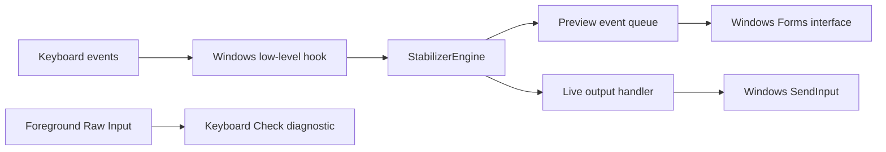
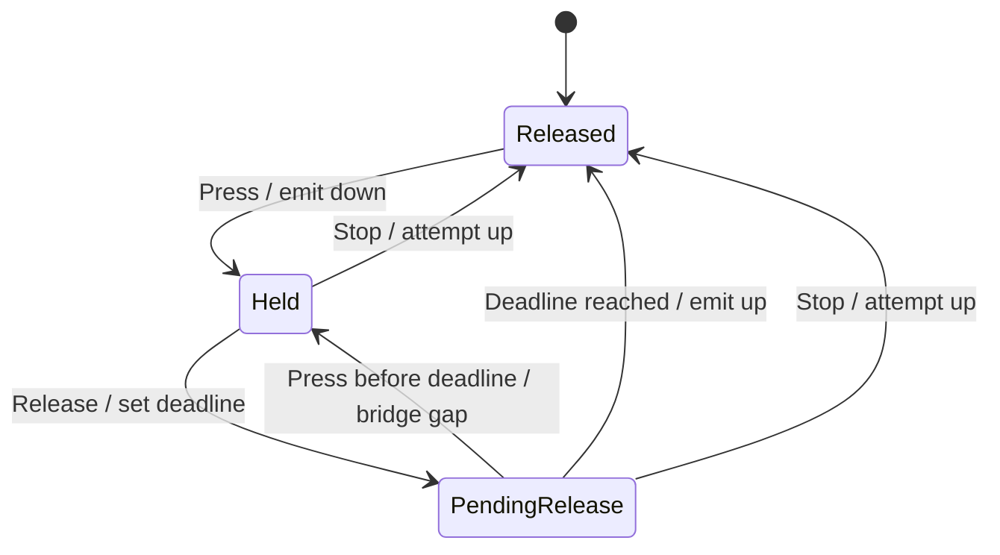

# Architecture

## Components

The operating-system hook runs only during an armed or active stabilizer session. The engine does not call Windows APIs. Its host supplies monotonic timestamps and an output callback.

## Source map

| File | Responsibility |
| --- | --- |
| `Stabilizer.Engine.cs` | Per-key state, release deadlines, repeated taps, counters, and release cleanup |
| `Stabilizer.Windows.cs` | Native structures, input hook, worker thread, target checks, timers, F8, and `SendInput` |
| `Stabilizer.App.cs` | Key selection, settings, target list, preview display, example, and application lifetime |
| `Stabilizer.Tests.cs` | Deterministic engine checks and native structure sizes |
| `Stabilizer.NativeSmoke.cs` | Optional hook startup and shutdown check without an active target |
| `KeyboardCheck.cs` | Separate Raw Input diagnostic, settings reader, and tracker tests |
| `Build-Stabilizer.ps1` | Stabilizer compiler commands and optional checks |
| `Build.ps1` | Diagnostic compiler commands and tracker checks |
| `GamingStartup.ps1` | Separate startup inspection, backup, modification, and restoration |
| `UndoGamingStartup.ps1` | Restore wrapper with an explicit backup path |

## Smooth hold state

Each selected key has a physical state, a filtered state, and an optional release deadline.

A repeated key-down while the physical state is already down does not create another press. An orphan release does not create output.

`Input()` calls `Advance()` before it handles a selected event. An expired release therefore ends before a later press, even when a timer callback was late. A press at the exact deadline starts a separate hold.

The engine updates filtered state after the output callback succeeds. A failed output remains visible to cleanup. `Stop()` attempts releases for all keys, even if one release fails.

## Repeated taps

The first press starts a tap immediately. Each tap has a nominal down duration of `10 ms` in the application. The configured interval determines the next tap deadline.

When the timer is late, the engine emits no accumulated burst of overdue taps. It restarts the cadence from the current time. A reported physical release prevents new taps while its release deadline is pending.

## Thread model

The interface runs on the main Windows Forms thread. `InputRunner` creates a separate single-threaded apartment with its own Windows message loop.

`HookContext` owns the hook, state machine, hidden hotkey window, and worker timer. These components execute on the worker thread. A concurrent queue transfers output summaries to the interface. The queue retains at most `120` event messages.

The worker timer requests a `5 ms` interval. Windows scheduling determines actual callback times. The interface refreshes every `100 ms`. Neither interval is a latency guarantee.

## Session lifecycle

1. The application captures the selected keys, mode, timing values, and target identity.
2. The worker registers F8 and installs `WH_KEYBOARD_LL`.
3. The worker waits for the target and released selected keys.
4. The worker activates the session.
5. The worker processes selected events until a stop condition occurs.
6. Stop attempts outstanding releases, removes the hook, and unregisters F8.

The arming limit is `30 seconds`. The active-session limit is `120000 ms`. Target matching uses both the window handle and process identifier.

## Input boundary

The hook ignores events with injected-input flags. This rule prevents the program from processing its own output again. The rule also excludes events from many software keyboard tools.

Preview passes original input to the next hook. Live mode suppresses selected original events after the engine processes them. Other keys continue through the hook chain, except the reserved physical F8 stop press.

Live output uses scan-code `SendInput` events with a project marker in `dwExtraInfo`. The marker does not bypass Windows permissions or anti-cheat systems.

Target checks are best-effort focus checks. `SendInput` has no target-window argument. A focus change can occur between a check and injection. Cleanup can send a release after another window becomes active.

## Separate diagnostic

Keyboard Check registers foreground Raw Input without background-input flags. It uses device, scan, extended-flag, and virtual-key information to separate key records.

The diagnostic retains up to `150` recent transitions. Focus loss clears transient held state and release timing. Counts remain until reset or closure.

The diagnostic reads accessibility settings through `SystemParametersInfo`. It does not write those settings. The optional startup scripts are independent of both applications.
